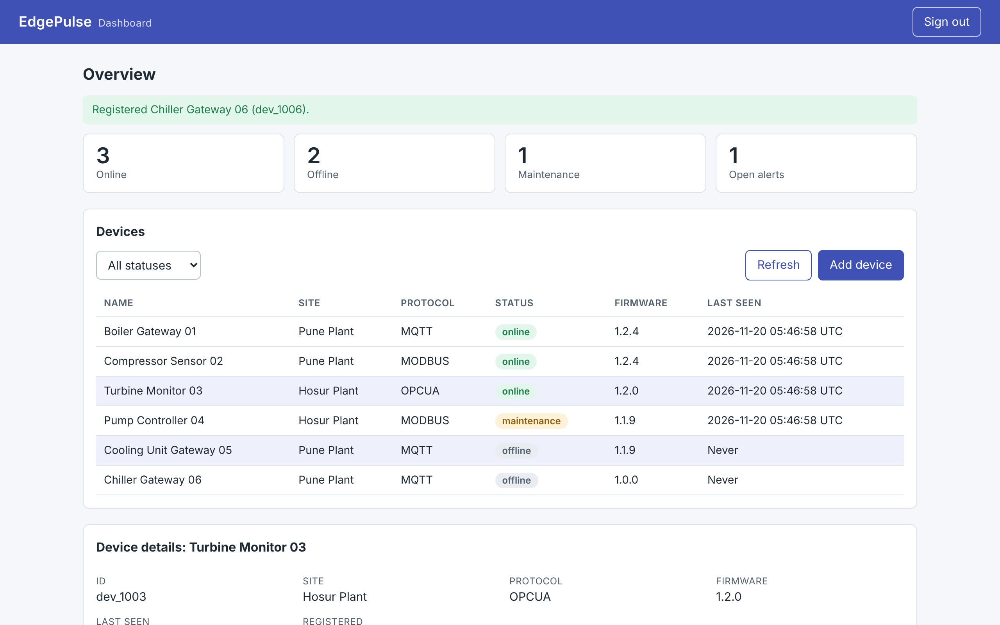
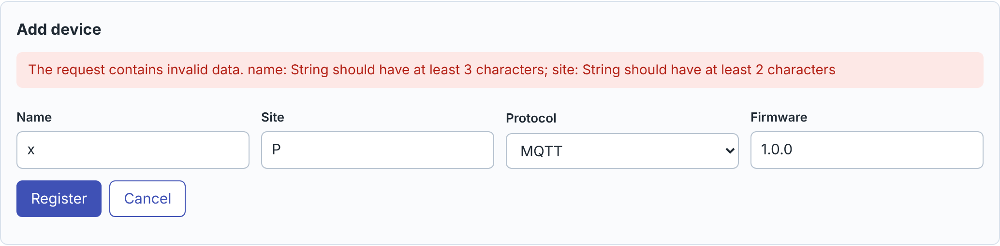
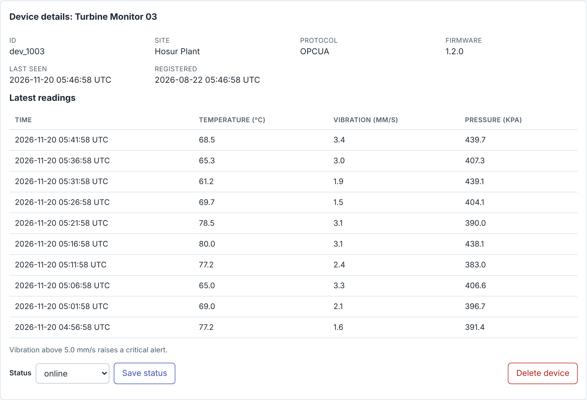

# Administrator guide

- **Audience:** Administrators who configure, secure and manage an EdgePulse installation.
- **Document type:** Administrator guide
- **Applies to:** EdgePulse 1.2
- **Last updated:** 2026-11-20

## Overview

This guide explains how to configure the API credentials, manage devices from the dashboard, check the health of the service, and keep an installation secure.

## Purpose

After you read this guide, you can:

- Replace the default credentials.
- Register, update and delete devices.
- Check that the service is running.
- Understand the limits of the demo installation.

## Prerequisites

- A running EdgePulse installation. See the [installation guide](../installation/index.md).
- Control over how the server is started, so that you can set environment variables.
- Dashboard credentials.

## Key concepts

### Configuration

| Setting | Environment variable | Default | Description |
|---|---|---|---|
| Client ID | `EDGEPULSE_CLIENT_ID` | `demo-client` | The ID that clients send to get a token. |
| Client secret | `EDGEPULSE_CLIENT_SECRET` | `demo-secret` | The secret that clients send to get a token. |

### Fixed behavior

These values are part of the application and cannot be configured.

| Behavior | Value |
|---|---|
| Access token lifetime | 3600 seconds |
| Automatic critical alert | Vibration above 5.0 mm/s |
| Data storage | In memory. All data is lost when the server stops. |
| Credentials | One client ID and secret pair for the whole installation |

### Device life cycle

A new device starts as `offline`. It becomes `online` when it sends its first reading. An administrator can set it to `maintenance` to take it out of normal monitoring, and can delete it when it is no longer needed.

## Procedures

### Change the API credentials

1. Stop the server with **Ctrl+C**.
2. Set the two environment variables, and then start the server in the same terminal.

    Linux, macOS and Git Bash:

    ```bash
    export EDGEPULSE_CLIENT_ID=ops-team
    export EDGEPULSE_CLIENT_SECRET='<your-secret>'
    uvicorn app.main:app --port 8000
    ```

    Windows Command Prompt:

    ```text
    set EDGEPULSE_CLIENT_ID=ops-team
    set EDGEPULSE_CLIENT_SECRET=<your-secret>
    uvicorn app.main:app --port 8000
    ```

3. Request a token with the new credentials to verify the change.

    ```bash
    curl -X POST http://localhost:8000/api/v1/auth/token \
      -H "Content-Type: application/json" \
      -d '{"client_id": "ops-team", "client_secret": "<your-secret>"}'
    ```

**Expected result:** The request returns status `200` and a token. A request with the old `demo-client` credentials returns status `401`.

!!! note "Restarting signs everyone out"
    Access tokens are held in memory. When you restart the server, every existing token becomes invalid, and clients must request a new one.

!!! warning "The sign-in form still pre-fills the demo values"
    The dashboard sign-in form always shows the demo credentials as defaults. Enter your own credentials. To remove the defaults, edit the two `value` attributes in `api-demo/app/static/dashboard.html`.

### Register a device

1. Sign in to the dashboard.
2. Select **Add device**.
3. Enter the device details.

    | Field | Rule |
    |---|---|
    | **Name** | 3 to 64 characters. |
    | **Site** | 2 to 64 characters. |
    | **Protocol** | MQTT, OPCUA or MODBUS. |
    | **Firmware** | The installed version. The default is `1.0.0`. |

4. Select **Register**.

**Expected result:** A green message confirms the registration, for example "Registered Chiller Gateway 06 (dev_1006)." The device appears in the **Devices** table with the status **offline**.



*Figure 1. A newly registered device.*

If a field breaks a rule, a red message in the form lists each field and the problem. The values you typed stay in the form.



*Figure 2. A validation message in the Add device form.*

### Change a device status

1. In the **Devices** table, select the device.
2. In **Device details**, open the **Status** list and select a status.
3. Select **Save status**.

**Expected result:** A green message confirms the change, for example "Status set to maintenance." The table and the counters show the new status.



*Figure 3. Device details with the status and delete controls.*

### Delete a device

1. In the **Devices** table, select the device.
2. Select **Delete device**.
3. In the confirmation dialog, select **OK**.

**Expected result:** A green message confirms the deletion. The device no longer appears in the table.

!!! warning
    Deleting a device also deletes its readings and alerts. This cannot be undone.

### Check the health of the service

Send a request to the health endpoint. It needs no token.

```bash
curl http://localhost:8000/api/v1/health
```

**Expected result:** The response contains `"status":"ok"`, the API version and the server time in UTC. Use this endpoint for uptime monitoring.

### Reset the demo data

Stop and restart the server. The data returns to the original demo set.

## Security best practices

- Replace the default credentials before you make the API reachable from any other computer.
- Do not commit the client secret to Git. Set it as an environment variable on the host.
- Use HTTPS. The application does not provide it, so use a host or reverse proxy that does.
- Keep the default `--host 127.0.0.1` unless clients on other computers must connect.
- Treat any installation that uses the default credentials as public.

## Limitations of the demo installation

| Limitation | Effect |
|---|---|
| Data is held in memory | A restart removes new devices, readings and alert changes. |
| One credential pair | You cannot create users, roles or per-user audit trails. The acknowledgement records the client ID. |
| No rate limiting | The API does not limit how often clients call it. |
| No HTTPS | Traffic is not encrypted unless a proxy or host adds HTTPS. |
| Fixed token lifetime and alert limit | You cannot change them without editing the source code. |

!!! note "Free hosting"
    On Render's free tier, a service sleeps after 15 minutes without traffic. The first request after that can take about one minute, and the data resets when the service restarts. See the [Render documentation](https://render.com/docs/free).

## Troubleshooting

| Problem | Cause | Solution |
|---|---|---|
| The new credentials return `401`. | The variables were not set in the terminal that started the server. | Stop the server, set the variables, and start the server again in the same terminal. |
| Clients get `401` after a restart. | The restart invalidated all tokens. | Clients request a new token. |
| **Register** shows "The request contains invalid data." | A field is too short or too long. | Follow the length rules in the table above. |
| A device you added is gone. | The server restarted. | Register the device again. See the limitations table. |

## Related information

- [Installation guide](../installation/index.md)
- [Authentication guide](../api/authentication.md)
- [Dashboard user guide](../user-guide/index.md)
- [API reference](../api/reference.md)
