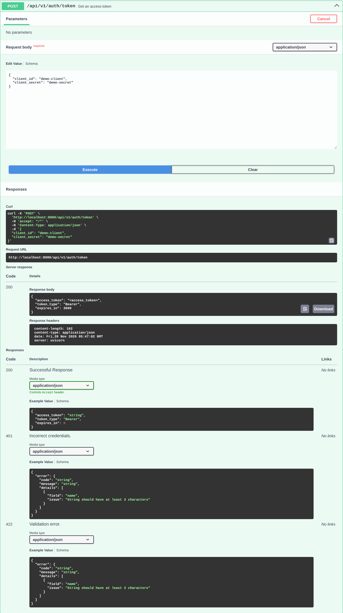
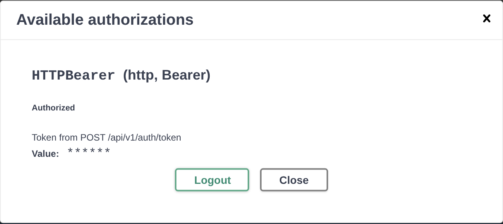
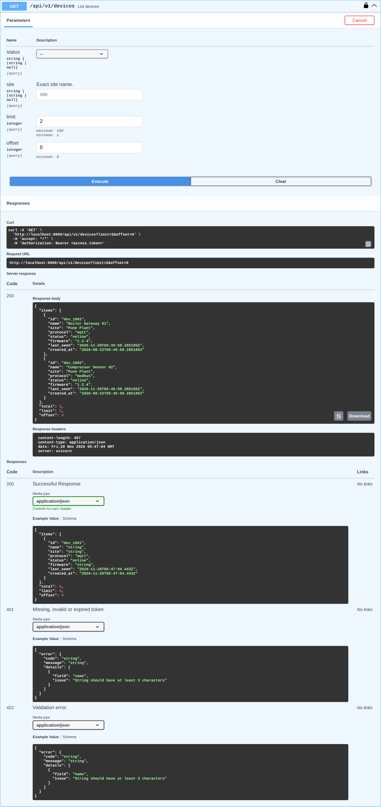

# API authentication guide

- **Audience:** Developers who connect an application to the EdgePulse API.
- **Document type:** Developer guide
- **Applies to:** EdgePulse API 1.2.0
- **Last updated:** 2026-11-20

## Overview

The EdgePulse API uses bearer tokens. Your application exchanges a client ID and secret for a short-lived access token, and then sends that token with every request.

## Purpose

After you read this guide, you can get a token, use it, and handle an expired token in your own code.

## Prerequisites

- A running EdgePulse API. See the [quick start](../quick-start/index.md).
- A client ID and client secret. The demo values are `demo-client` and `demo-secret`.

## Key concepts

| Term | Definition |
|---|---|
| **Client credentials** | The client ID and client secret that identify your application. |
| **Access token** | A random string that proves your application signed in. It is valid for 3600 seconds. |
| **Bearer token** | A token sent in the `Authorization` header as `Bearer <access_token>`. |

Only two endpoints work without a token: `GET /api/v1/health` and `POST /api/v1/auth/token`. Every other endpoint requires one.


*Figure 1. The token life cycle.*

## Procedures

### Get a token with curl

1. Send your credentials to the token endpoint.

    ```bash
    curl -X POST http://localhost:8000/api/v1/auth/token \
      -H "Content-Type: application/json" \
      -d '{"client_id": "demo-client", "client_secret": "demo-secret"}'
    ```

2. Copy the `access_token` value from the response.

**Expected result:** Status `200` and a response like this. The token value differs on every request.

```json
{
    "access_token": "<access_token>",
    "token_type": "Bearer",
    "expires_in": 3600
}
```

### Use the token

Add the header `Authorization: Bearer <access_token>` to each request.

```bash
curl http://localhost:8000/api/v1/devices \
  -H "Authorization: Bearer <access_token>"
```

**Expected result:** Status `200` and a list of devices.

### Get a token in Swagger UI

1. Open <http://localhost:8000/docs>.
2. Expand **POST /api/v1/auth/token** and select **Try it out**.
3. Select **Execute**. The request body already contains the demo credentials.
4. In **Response body**, copy the `access_token` value.



*Figure 2. A token request in Swagger UI. The token is masked in this screenshot.*

5. Select **Authorize** at the top of the page.
6. Paste the token into **Value**, and select **Authorize**.

**Expected result:** The dialog shows **Authorized**, and the token value appears as asterisks. Select **Close**.



*Figure 3. Swagger UI after authorization.*

7. Expand any other operation, such as **GET /api/v1/devices**, select **Try it out**, and select **Execute**.

**Expected result:** The request succeeds. The generated `curl` command in Swagger UI includes your token.



*Figure 4. An authorized request in Swagger UI.*

### Get a token in Python

Save this code as `get_token.py` and run it with `python get_token.py`. It needs the `requests` package.

```python
import requests

BASE_URL = "http://localhost:8000"

response = requests.post(
    f"{BASE_URL}/api/v1/auth/token",
    json={"client_id": "demo-client", "client_secret": "demo-secret"},
    timeout=90,
)
response.raise_for_status()
token = response.json()

print("Token type:", token["token_type"])
print("Expires in:", token["expires_in"], "seconds")

devices = requests.get(
    f"{BASE_URL}/api/v1/devices",
    headers={"Authorization": f"Bearer {token['access_token']}"},
    timeout=90,
)
print("Devices request status:", devices.status_code)
print("Devices returned:", devices.json()["total"])
```

**Expected result:**

```text
Token type: Bearer
Expires in: 3600 seconds
Devices request status: 200
Devices returned: 5
```

### Get a token in JavaScript

Save this code as `get_token.mjs` and run it with `node get_token.mjs`. It needs Node.js 18 or later, which includes `fetch`.

```javascript
const BASE_URL = "http://localhost:8000";

const tokenResponse = await fetch(`${BASE_URL}/api/v1/auth/token`, {
  method: "POST",
  headers: { "Content-Type": "application/json" },
  body: JSON.stringify({ client_id: "demo-client", client_secret: "demo-secret" }),
});
if (!tokenResponse.ok) {
  const { error } = await tokenResponse.json();
  throw new Error(`${tokenResponse.status} ${error.code}: ${error.message}`);
}
const token = await tokenResponse.json();
console.log("Token type:", token.token_type);
console.log("Expires in:", token.expires_in, "seconds");

const devices = await fetch(`${BASE_URL}/api/v1/devices`, {
  headers: { Authorization: `Bearer ${token.access_token}` },
});
console.log("Devices request status:", devices.status);
console.log("Devices returned:", (await devices.json()).total);
```

**Expected result:** The same four lines as the Python example.

### Handle an expired token

A token stops working after 3600 seconds. The API then returns status `401` with the code `unauthorized`. There is no refresh token. Request a new token, and retry the original request once.

The [developer guide](../developer-guide/index.md#a-reusable-client) contains a Python client that does this for you.

## Authentication errors

| Status | Code | Cause | Solution |
|---|---|---|---|
| 401 | `invalid_credentials` | The client ID or secret is wrong. | Check the credentials. |
| 401 | `unauthorized` | The token is missing, mistyped or expired. | Send the `Authorization` header, or request a new token. |
| 422 | `validation_error` | The token request is missing `client_id` or `client_secret`. | Send both fields. See `error.details`. |

Example of a failed token request:

```json
{
    "error": {
        "code": "invalid_credentials",
        "message": "The client ID or client secret is incorrect."
    }
}
```

## Best practices

- Request a token once and reuse it until it expires. Do not request a token for every call.
- Keep the client secret out of source code and out of Git. Read it from an environment variable.
- Send tokens only over HTTPS when you use a hosted API.
- Never print or log a full token.
- Treat the demo credentials as public.

## Troubleshooting

| Problem | Cause | Solution |
|---|---|---|
| Every request returns `401`. | The header is wrong. | Use exactly `Authorization: Bearer <access_token>`, with one space after `Bearer`. |
| Requests worked, then returned `401`. | The token expired. | Request a new token. |
| Swagger UI returns `401` after **Authorize**. | The token was pasted with extra characters or expired. | Copy the token again, without quotation marks. |

## Related information

- [API reference](reference.md)
- [Developer guide](../developer-guide/index.md)
- [Administrator guide](../admin-guide/index.md#change-the-api-credentials)
