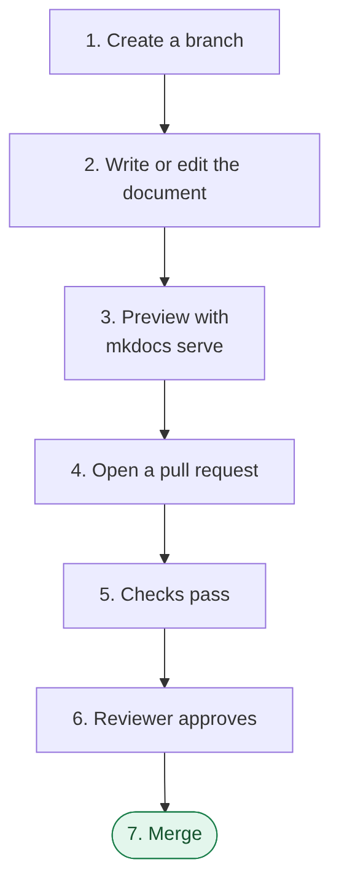

# Contribution guide

Last updated: 2026-11-21

## Overview

This guide explains how to propose a change to the EdgePulse documentation or the demo API.

**Audience:** Writers, reviewers and engineers.

## Prerequisites

- A GitHub account.
- The tools in the [Docs-as-Code pipeline](pipeline.md).
- You read the [Style guide](style-guide.md).

## Workflow



*Figure 1. The contribution flow.*

## Procedure

1. Create a branch from `main`. Use a clear name, such as `docs/fix-token-example`.

    ```bash
    git checkout -b docs/fix-token-example
    ```

2. Make your change. Follow the [Style guide](style-guide.md).
3. Update the **Last updated** date of every document that you change.
4. Preview the site with `mkdocs serve`.
5. Run the checks. See [Run the checks locally](pipeline.md#run-the-checks-locally).
6. Commit with a short message in the imperative mood, for example "Fix token lifetime in the quick start".
7. Push the branch and open a pull request. Describe what changed and why.
8. Respond to review comments. The pull request merges after the checks pass and a reviewer approves.

## Review checklist

Reviewers confirm that:

- [ ] The content is accurate and was tested.
- [ ] The document follows the standard structure.
- [ ] Code listings match the files in `examples/`.
- [ ] Every image has alt text.
- [ ] Links work and the strict build passes.
- [ ] No secrets, tokens or personal data appear in text or screenshots.
- [ ] The **Last updated** date is current.

## Report a problem

Open a GitHub issue. Include the page, the problem and, if possible, a suggested fix.

## Best practices

- Keep pull requests small and focused.
- Change code and its documentation in the same pull request.
- Mask tokens in screenshots.

## Related information

- [Docs-as-Code pipeline](pipeline.md)
- [Style guide](style-guide.md)
