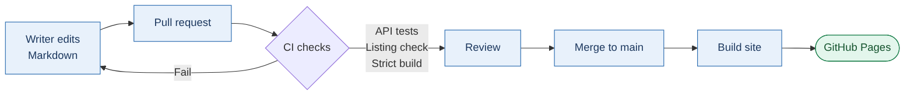

# Docs-as-Code pipeline

Last updated: 2026-11-21

## Overview

Docs-as-Code means that documentation is managed with the same tools as software: plain-text files, version control and automated builds. This guide explains how the EdgePulse documentation is built, checked and published.

**Audience:** Writers, reviewers and engineers who maintain the documentation.

## Purpose

After you read this guide, you can build the site locally, understand each automated check and fix a failed build.

## Prerequisites

- Python 3.10 or later.
- Git.
- Node.js 18 or later and the Mermaid CLI (`mmdc`), only if you change a diagram.

## Key concepts

- **Source files.** Markdown files in `docs/`. Diagram sources are in `docs/assets/diagrams/source/`.
- **Static site generator.** MkDocs with the Material theme turns the Markdown files into a website.
- **Continuous integration (CI).** GitHub Actions runs checks on every pull request and every push to `main`.
- **Strict build.** A build mode that fails on any warning, such as a broken link.

## The pipeline



*Figure 1. The documentation pipeline.*

The workflow file is `.github/workflows/docs.yml`. It runs three checks and then deploys.

| Step | Command | What it proves |
|---|---|---|
| API tests | `python -m pytest -q` in `api-demo/` | The demo API behaves as documented. |
| Listing check | `python scripts/check_examples_in_docs.py` | Each code listing in the guides is identical to its tested file in `examples/`. |
| Strict build | `mkdocs build --strict` | The site builds with no broken links or missing files. |
| Deploy | `actions/deploy-pages` | The site is published. This step runs only on `main`. |

## Build the site locally

1. Create and activate a virtual environment.

    ```bash
    python -m venv .venv
    source .venv/bin/activate
    ```

2. Install the dependencies.

    ```bash
    pip install -r requirements.txt
    ```

3. Start the preview server.

    ```bash
    mkdocs serve
    ```

4. Open `http://127.0.0.1:8000`. The page reloads when you save a file.

!!! note "Port conflict"
    The demo API also uses port 8000. Run `mkdocs serve --dev-addr 127.0.0.1:8001` if both run together.

## Run the checks locally

Run these commands before you open a pull request:

```bash
(cd api-demo && pip install -r requirements.txt && python -m pytest -q)
python scripts/check_examples_in_docs.py
mkdocs build --strict
```

## Regenerate the API reference

The page `docs/api/reference.md` is generated. It contains the real responses from a test run.

1. Start a fresh demo server.
2. Run `python scripts/build_api_reference.py`.
3. Review and commit the changed file.

Do not edit `reference.md` by hand. Edit `scripts/templates/api-reference.template.md` instead.

## Update a diagram

1. Edit the `.mmd` file in `docs/assets/diagrams/source/`.
2. Export both formats:

    ```bash
    mmdc -i docs/assets/diagrams/source/NAME.mmd -o docs/assets/diagrams/exports/NAME.png -s 2 -b white
    mmdc -i docs/assets/diagrams/source/NAME.mmd -o docs/assets/diagrams/exports/NAME.svg
    ```

3. Open the PNG file and check that no label overlaps.

## Publish for the first time

1. In the repository, select **Settings** > **Pages**.
2. Under **Build and deployment**, set **Source** to **GitHub Actions**.
3. Push to `main`. The workflow publishes the site.

## Troubleshooting

| Symptom | Cause | Fix |
|---|---|---|
| The build fails with a warning about a link | A link target does not exist. | Fix the path. Strict mode treats warnings as errors. |
| The listing check fails | A code listing in a guide differs from its example file. | Copy the example file into the guide again. |
| The deploy job does not run | The branch is not `main`, or Pages is not set to GitHub Actions. | Check the branch and the Pages setting. |
| The deploy job fails with a permissions error | Pages is not enabled for the repository. | Complete "Publish for the first time". |

!!! warning "Free plan"
    GitHub Pages is available for public repositories on the free plan. A private repository needs a paid plan.

## Best practices

- Keep one topic in one file.
- Run the strict build before every pull request.
- Pin tool versions in `requirements.txt` and review Dependabot updates monthly.
- Keep generated files out of manual edits.

## Related information

- [Contribution guide](index.md)
- [Style guide](style-guide.md)
