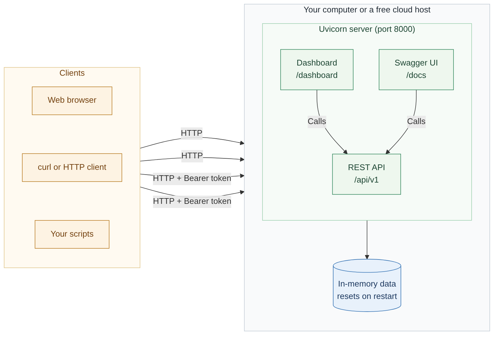

# Installation guide

- **Audience:** System administrators and developers who install the EdgePulse demo API.
- **Document type:** Installation guide
- **Applies to:** EdgePulse 1.2
- **Last updated:** 2026-11-20

## Overview

The EdgePulse demo API is one Python application. A single server process provides the REST API, the dashboard and the interactive Swagger UI. It keeps its data in memory, so it needs no database.



*Figure 1. EdgePulse deployment.*

## Purpose

Use this guide to install, start, verify and stop the demo API on your own computer or server.

## Prerequisites

| Requirement | Details |
|---|---|
| Operating system | Linux, macOS or Windows. The procedures were tested on Linux. |
| Python | 3.10 or later. Tested with 3.13. |
| `pip` | Included with current Python installers. |
| Network | Internet access to download packages from PyPI. |
| Port | A free TCP port. The examples use 8000. |
| Disk space | Less than 100 MB, including dependencies. |

## Procedure

### Install

1. Get the source code.

    ```bash
    git clone https://github.com/rpattanaik04/edgepulse-docs.git
    cd edgepulse-docs/api-demo
    ```

    Alternatively, download the repository as a ZIP file from GitHub, unpack it, and open the `api-demo` folder.

2. Create a virtual environment.

    ```bash
    python -m venv .venv
    ```

3. Activate it.

    | Shell | Command |
    |---|---|
    | Linux and macOS | `source .venv/bin/activate` |
    | Windows Command Prompt | `.venv\Scripts\activate` |
    | Windows PowerShell | `.venv\Scripts\Activate.ps1` |

4. Install the dependencies.

    ```bash
    pip install -r requirements.txt
    ```

### Start the server

Run:

```bash
uvicorn app.main:app --port 8000
```

**Expected result:**

```text
INFO:     Application startup complete.
INFO:     Uvicorn running on http://127.0.0.1:8000 (Press CTRL+C to quit)
```

### Verify the installation

1. Run the automated tests. Open a second terminal, activate the environment, and run:

    ```bash
    cd edgepulse-docs/api-demo
    pytest
    ```

    **Expected result:** All tests pass. The last line looks like `17 passed in 0.44s`.

2. Check the service.

    ```bash
    curl http://localhost:8000/api/v1/health
    ```

    **Expected result:** The response contains `"status":"ok"`.

3. Open the user interfaces in a browser.

    | Page | Address |
    |---|---|
    | Dashboard | <http://localhost:8000/dashboard> |
    | Swagger UI | <http://localhost:8000/docs> |
    | OpenAPI specification | <http://localhost:8000/openapi.json> |

### Stop the server

Press **Ctrl+C** in the terminal where the server runs.

### Uninstall

Delete the `edgepulse-docs` folder. The application writes no files outside it.

## Startup options

| Option | Purpose | Example |
|---|---|---|
| `--port` | Use a different port. | `--port 8001` |
| `--host` | Listen on all network interfaces. The default is `127.0.0.1`, which accepts connections only from your computer. | `--host 0.0.0.0` |

!!! warning "Do not expose the demo API to an untrusted network"
    The demo API does not use HTTPS, and its default credentials are public. Before you use `--host 0.0.0.0`, [change the credentials](../admin-guide/index.md#change-the-api-credentials) and place the server behind a service that provides HTTPS.

## Troubleshooting

| Problem | Cause | Solution |
|---|---|---|
| `python: command not found` | Python is not installed or is not on the path. | Install Python 3.10 or later. On some systems, use `python3` instead. |
| `uvicorn: command not found` | The environment is not active, or the dependencies are not installed. | Activate the environment, then run `pip install -r requirements.txt`. |
| `ModuleNotFoundError: No module named 'app'` | You started the server from the wrong folder. | Run the command from the `api-demo` folder. |
| An "address already in use" error | Another program uses the port. | Use `--port` with a free port. |
| The dashboard does not open from another computer | The server listens only on `127.0.0.1`. | Start with `--host 0.0.0.0`, after you read the warning above. |
| The Swagger UI page is blank | Swagger UI loads its files from a public content delivery network (CDN). Your network may block it. | Allow access to `cdn.jsdelivr.net`, or use the dashboard and `curl` instead. |

## Related information

- [Quick start](../quick-start/index.md)
- [Administrator guide](../admin-guide/index.md)
- [Product overview](../overview/index.md)
