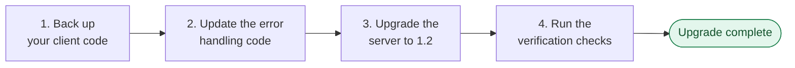

# Upgrade guide: 1.1 to 1.2

Last updated: 2026-11-21

## Overview

Version 1.2 changes the format of error responses. Your client code must read the new format. Other behavior is unchanged.

**Audience:** Developers who maintain code that calls the EdgePulse API.

## Purpose

After you complete this guide, your client handles errors from version 1.2 correctly.

## Prerequisites

- Access to the source code of your API client.
- A test instance of EdgePulse 1.2.

!!! note "Fictional history"
    The 1.1 error format described here is part of the fictional version history. See the [release notes](../release-notes/index.md).

## What changed

| Item | 1.1 | 1.2 |
|---|---|---|
| Error body | `{"detail": "Device not found"}` | `{"error": {"code": "device_not_found", "message": "..."}}` |
| Machine-readable code | Not available | `error.code` |
| Validation problems | One text string | One item per field in `error.details` |

## Upgrade path



*Figure 1. Upgrade path.*

## Procedure

1. Back up your client code, or create a Git branch.
2. Find every place that reads `detail` from an error response.
3. Replace each one with the new fields.

    Before:

    ```python
    message = response.json()["detail"]
    ```

    After:

    ```python
    error = response.json()["error"]
    code, message = error["code"], error["message"]
    ```

4. Decide actions by `error.code`, for example, get a new token for `unauthorized`.
5. Upgrade the server to 1.2.
6. Run your tests against the upgraded server.

## Expected results

Call a device that does not exist. The response is:

```json
{
  "error": {
    "code": "device_not_found",
    "message": "No device exists with the given ID."
  }
}
```

## Troubleshooting

| Symptom | Cause | Fix |
|---|---|---|
| `KeyError: 'detail'` | The client still reads the 1.1 format. | Complete step 3. |
| An error shows `None` for the code | The code reads the wrong field. | Read `error["code"]`, not `code`. |

## Best practices

- Test the upgrade on a non-production instance first.
- Handle errors by `error.code`.

## Related information

- [Release notes](../release-notes/index.md)
- [Troubleshooting guide](../troubleshooting/index.md)
