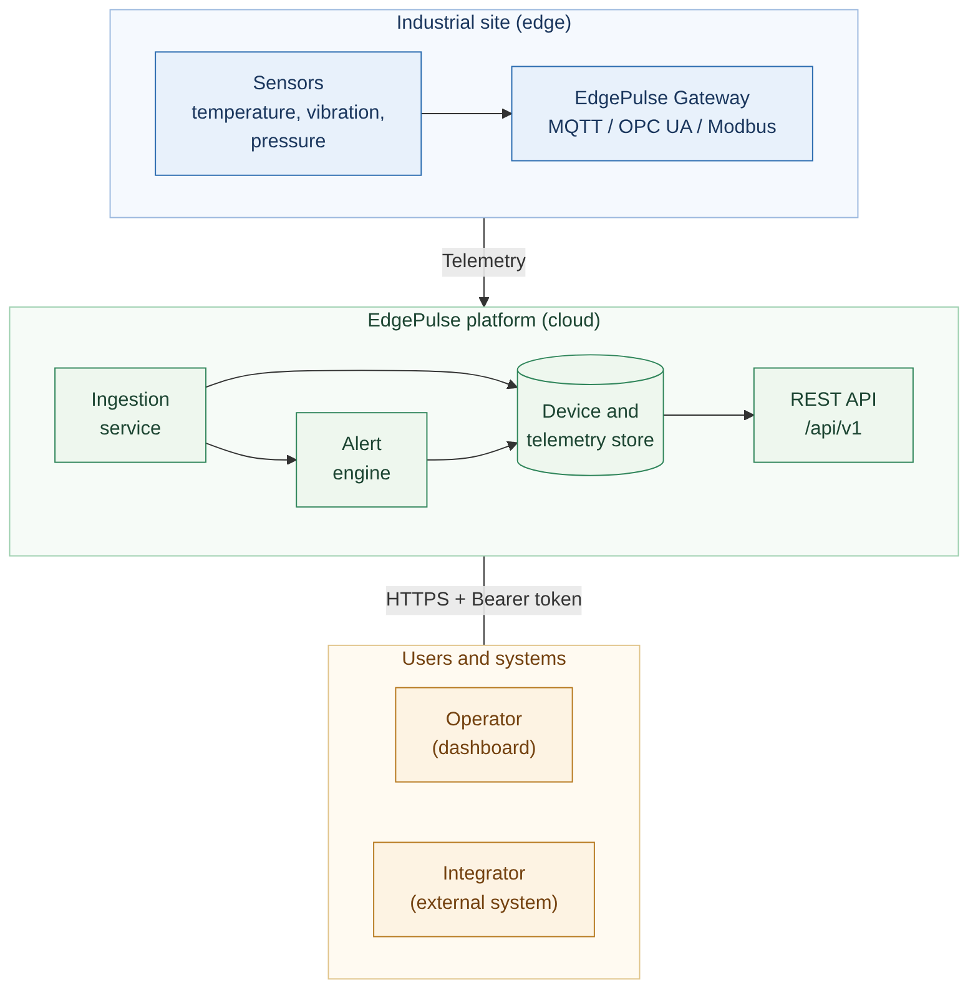

# EdgePulse product overview

- **Audience:** Evaluators, operators, administrators and developers who are new to EdgePulse.
- **Document type:** Concept overview
- **Applies to:** EdgePulse 1.2
- **Last updated:** 2026-11-20

## Overview

EdgePulse is a monitoring platform for industrial equipment. It collects sensor readings from devices at your site, stores them in the cloud, raises alerts when readings go outside safe limits, and exposes everything through a REST API.

!!! note "Demonstration project"
    EdgePulse is a fictional product created for a technical documentation portfolio. The REST API described in this documentation is real and runnable. All names, sites and readings are fictional. See [What is real and what is fictional](#what-is-real-and-what-is-fictional).

## Purpose

Use EdgePulse to:

- Know which devices are online, offline or under maintenance.
- Review temperature, vibration and pressure readings for each device.
- Receive an alert when a reading exceeds its limit, and record who acknowledged it.
- Connect EdgePulse data to your own systems through the API.

## Key concepts

| Term | Definition |
|---|---|
| **Site** | A physical location, such as a plant, that contains devices. |
| **Device** | A piece of monitored equipment or the gateway attached to it. Each device has an ID, a name, a site, a protocol, a status and a firmware version. |
| **Gateway** | Edge software that reads sensors and forwards readings to the platform. |
| **Telemetry** | A reading sent by a device: temperature (°C), vibration (mm/s) and pressure (kPa). |
| **Alert** | A notice raised when a reading exceeds a limit. An alert is *open* until someone acknowledges it. |
| **Access token** | A short-lived credential that an application sends with each API request. |

### Device status

| Status | Meaning |
|---|---|
| `online` | The device has reported recently. |
| `offline` | The device has not reported, or is newly registered. |
| `maintenance` | An administrator has taken the device out of normal monitoring. |

### Alert severity

| Severity | Typical use |
|---|---|
| `info` | An event that needs no action, such as a firmware update. |
| `warning` | A condition that needs attention, such as a device that stopped reporting. |
| `critical` | A reading beyond a safety limit. Example: vibration above 5.0 mm/s. |

## How EdgePulse works

Sensors connect to an EdgePulse gateway at your site. The gateway reads data over MQTT, OPC UA or Modbus and sends it to the cloud platform. The platform stores each reading, checks it against alert rules, and makes the data available through the REST API.

*Figure 1. EdgePulse system context.*

## Supported protocols

| Protocol | Typical equipment |
|---|---|
| MQTT | Lightweight sensors and IoT gateways |
| OPC UA | Turbines, PLCs and modern industrial controllers |
| Modbus | Pumps, compressors and legacy controllers |

## Capabilities

- **Device management.** Register, update and remove devices.
- **Telemetry.** Submit readings and retrieve recent history, newest first.
- **Alerting.** Critical alerts are raised automatically when vibration exceeds 5.0 mm/s.
- **Acknowledgement.** Record who acknowledged an alert and when.
- **Filtering and paging.** Filter devices by status or site and page through results.
- **Consistent errors.** Every error uses the same JSON structure, so applications can handle failures predictably.

## What is real and what is fictional

| Real | Fictional |
|---|---|
| The REST API and a small operator dashboard: both run locally, and you can test the API in Swagger UI or with `curl` | The product name, brand and company |
| The OpenAPI 3.1 specification generated by the API | Sites, devices, readings and alerts |
| The industry protocols: MQTT, OPC UA, Modbus | Version history and release dates |
| The documentation tooling: MkDocs, GitHub Actions, GitHub Pages | The gateway, ingestion service and alert engine as shipped products |

!!! warning "Scope of the demo API"
    The demo API implements the device, telemetry, alert and authentication endpoints, and serves a small dashboard. It does not run a gateway, an MQTT broker or an OPC UA server. Data is held in memory and resets when the server restarts.

## Related information

- [Quick start](../quick-start/index.md)
- [Dashboard user guide](../user-guide/index.md)
- [Administrator guide](../admin-guide/index.md)
- [API reference](../api/reference.md)
- [Documentation style guide](../contributing/style-guide.md)
- [OpenAPI specification (YAML)](../api/openapi.yaml)
- [Source code for the demo API](https://github.com/rpattanaik04/edgepulse-docs/tree/main/api-demo)
