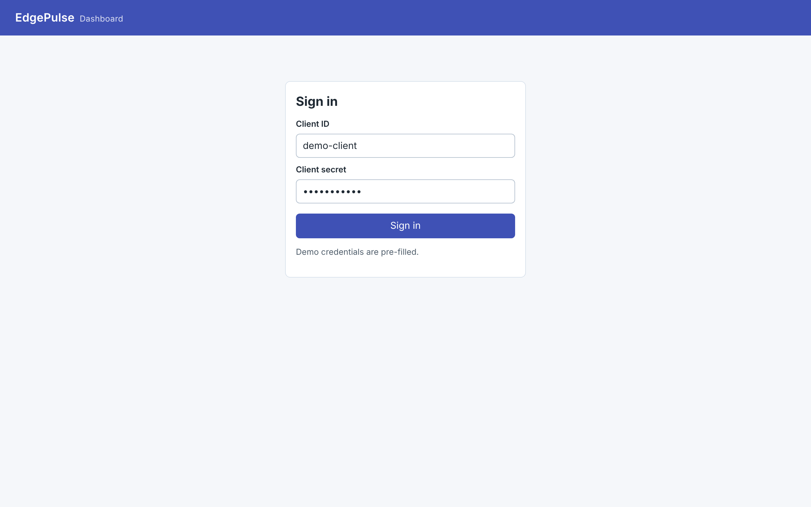
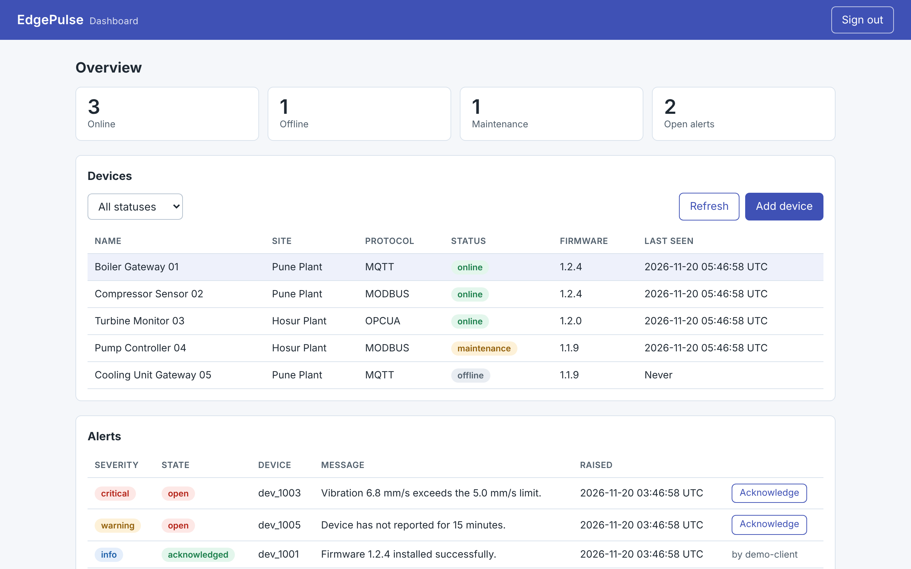
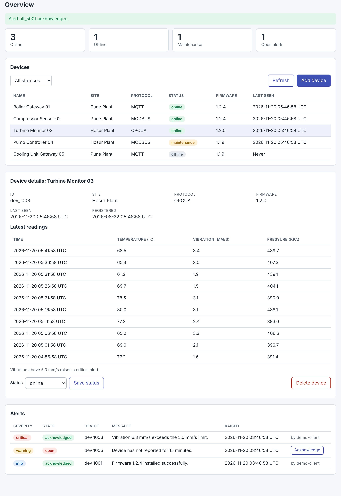

# Quick start

- **Audience:** Developers and evaluators who are new to EdgePulse.
- **Document type:** Quick start guide
- **Applies to:** EdgePulse 1.2
- **Last updated:** 2026-11-20
- **Time required:** About 10 minutes

## Overview

In this guide, you start the EdgePulse demo API, sign in to the dashboard, call the API, and raise and acknowledge an alert.

## Prerequisites

- Python 3.10 or later and `pip`. The procedures were tested with Python 3.13.
- `curl`.
- The EdgePulse repository on your computer:

    ```bash
    git clone https://github.com/rpattanaik04/edgepulse-docs.git
    ```

- A bash-style shell, such as Linux, macOS, Git Bash or WSL. The `curl` commands in step 3 use bash syntax. On other shells, use the dashboard or [Swagger UI](../api/authentication.md#get-a-token-in-swagger-ui) instead.

## Procedure

### 1. Start the API

1. Open a terminal and go to the `api-demo` folder.

    ```bash
    cd edgepulse-docs/api-demo
    ```

2. Create and activate a virtual environment.

    ```bash
    python -m venv .venv
    source .venv/bin/activate        # Windows: .venv\Scripts\activate
    ```

3. Install the dependencies.

    ```bash
    pip install -r requirements.txt
    ```

4. Start the server.

    ```bash
    uvicorn app.main:app --port 8000
    ```

**Expected result:** The terminal shows these lines. Leave the server running.

```text
INFO:     Application startup complete.
INFO:     Uvicorn running on http://127.0.0.1:8000 (Press CTRL+C to quit)
```

### 2. Sign in to the dashboard

1. Open a browser and go to <http://localhost:8000/dashboard>.
2. Leave the pre-filled demo credentials in place, and select **Sign in**.



*Figure 1. The dashboard sign-in page.*

**Expected result:** The **Overview** page opens. It shows four counters and two tables: **Devices** and **Alerts**. In the demo data, 3 devices are online, 1 is offline, 1 is in maintenance, and 2 alerts are open.



*Figure 2. The dashboard overview.*

### 3. Call the API

1. Check that the API is running.

    ```bash
    curl http://localhost:8000/api/v1/health
    ```

    The response shows `"status":"ok"`.

    ```json
    {"status":"ok","version":"1.2.0","time":"2026-11-20T05:48:34.555743Z"}
    ```

2. Request an access token and store it in a shell variable.

    ```bash
    TOKEN=$(curl -s -X POST http://localhost:8000/api/v1/auth/token \
      -H "Content-Type: application/json" \
      -d '{"client_id": "demo-client", "client_secret": "demo-secret"}' \
      | sed -E 's/.*"access_token":"([^"]+)".*/\1/')
    ```

3. List two online devices.

    ```bash
    curl -H "Authorization: Bearer $TOKEN" \
      "http://localhost:8000/api/v1/devices?status=online&limit=2"
    ```

**Expected result:** The response is a JSON object with an `items` array that contains `dev_1001` and `dev_1002`, and a `total` of 3. See the [API reference](../api/reference.md#list-devices) for the complete response.

!!! note
    The token lasts 3600 seconds. After that, repeat step 3.2 to get a new one.

### 4. Raise an alert

Send a reading with vibration above the 5.0 mm/s limit.

```bash
curl -X POST http://localhost:8000/api/v1/devices/dev_1001/telemetry \
  -H "Authorization: Bearer $TOKEN" \
  -H "Content-Type: application/json" \
  -d '{"temperature_c": 78.2, "vibration_mm_s": 6.4, "pressure_kpa": 421.0}'
```

**Expected result:** The API returns the stored reading. The timestamp differs.

```json
{"temperature_c":78.2,"vibration_mm_s":6.4,"pressure_kpa":421.0,"timestamp":"2026-11-20T05:48:34.576915Z","device_id":"dev_1001"}
```

### 5. Acknowledge the alert

1. In the dashboard, select **Refresh**.
2. In the **Alerts** table, find the new critical alert for `dev_1001`. Its message is "Vibration 6.4 mm/s exceeds the 5.0 mm/s limit."
3. Select **Acknowledge** in that row.

**Expected result:** A green message confirms the acknowledgement. The alert state changes to `acknowledged`, and the **Open alerts** counter decreases by one.



*Figure 3. The dashboard after an alert is acknowledged. The screenshot shows alert `alt_5001`.*

## Troubleshooting

| Problem | Cause | Solution |
|---|---|---|
| `uvicorn: command not found` | The virtual environment is not active, or the dependencies are not installed. | Activate the environment and run `pip install -r requirements.txt`. |
| An "address already in use" error when starting | Another program uses port 8000. | Start with another port, such as `--port 8001`, and use that port in every URL. |
| `401` with `unauthorized` | The token is missing, mistyped or expired. | Request a new token. |
| `TOKEN` is empty | The token request failed. | Run the token request without `-s` and read the error message. |
| The dashboard shows "Your session expired. Sign in again." | The token expired. | Sign in again. |

## Best practices

- Restart the server to reset the demo data after you experiment.
- Use the [API reference](../api/reference.md) for the full list of endpoints.

## Related information

- [Installation guide](../installation/index.md)
- [Dashboard user guide](../user-guide/index.md)
- [Authentication guide](../api/authentication.md)
- [Developer guide](../developer-guide/index.md)
