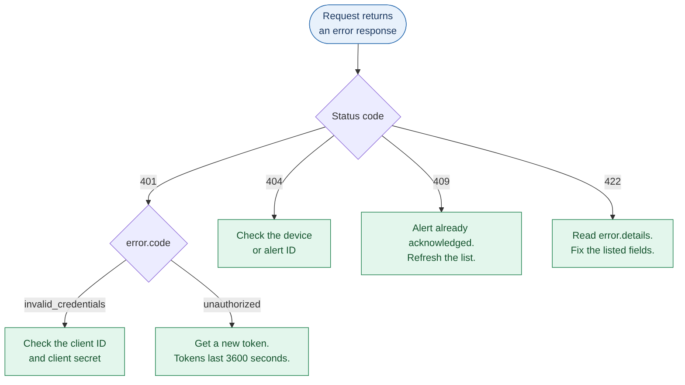

# Troubleshooting guide

Last updated: 2026-11-21

## Overview

This guide helps you find and fix problems when you use the EdgePulse API, dashboard and demo server. Start with the symptom that matches your problem.

**Audience:** Developers, administrators and support engineers.

## Prerequisites

- Access to the failing request, including its HTTP status code and response body.
- For server problems, access to the terminal that runs the server.

## Key concepts

Every API error uses the same format. The `error.code` value is stable. Use it, not the message text, to decide what to do.

```json
{
  "error": {
    "code": "device_not_found",
    "message": "No device exists with the given ID."
  }
}
```

## Find the cause of an API error



*Figure 1. Decision tree for error responses.*

If the request returns no response at all, check the URL and the port, and confirm that the server runs. On the free Render host, the first request after 15 minutes of idle time takes about one minute.

## API errors

| Status | `error.code` | Cause | Fix |
|---|---|---|---|
| 401 | `invalid_credentials` | The client ID or secret is wrong. | Check `EDGEPULSE_CLIENT_ID` and `EDGEPULSE_CLIENT_SECRET`. |
| 401 | `unauthorized` | The token is missing, invalid or older than 3600 seconds. | Request a new token. See the [Authentication guide](../api/authentication.md). |
| 404 | `device_not_found` | The device ID does not exist. | List devices and copy the ID. |
| 404 | `alert_not_found` | The alert ID does not exist. | List alerts and copy the ID. |
| 409 | `alert_already_acknowledged` | Another user acknowledged the alert. | Refresh the list. No action is needed. |
| 422 | `validation_error` | A field is missing or outside its range. | Read `error.details`. Each item names the field and the problem. |

## Server and setup problems

| Problem | Cause | Fix |
|---|---|---|
| Data is missing after a restart | The demo API stores data in memory. | Register the data again. This is expected behavior. |
| The first request takes about one minute | The free Render instance was idle and is starting. | Wait, then retry. Use a timeout of 90 seconds in scripts. |
| The Swagger UI page is blank | The page loads files from a content delivery network that your network blocks. | See the [Installation guide](../installation/index.md#troubleshooting). |
| Other installation errors | The environment is not set up. | See the [Installation guide](../installation/index.md#troubleshooting). |
| MQTT messages do not arrive | The topic, payload or device ID is wrong. | See the [MQTT integration guide](../integration/mqtt.md#troubleshooting). |

## Collect information for support

When you ask for help, include:

1. The request method, path and body. Remove tokens and secrets.
2. The HTTP status code and the full response body.
3. The API version from `GET /api/v1/health`.
4. The time of the request in UTC.

## Best practices

- Handle errors by `error.code`, not by message text.
- Get a new token and retry once when you receive `unauthorized`.
- Never post tokens or client secrets in a support request.

## Related information

- [API reference: error codes](../api/reference.md#error-codes)
- [FAQ](../help-center/faq.md)
