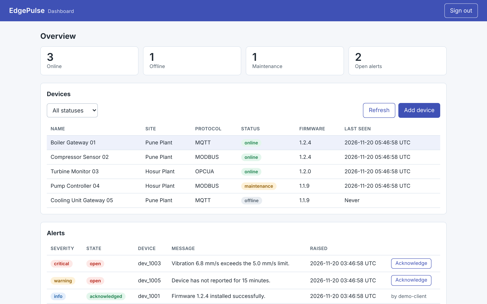
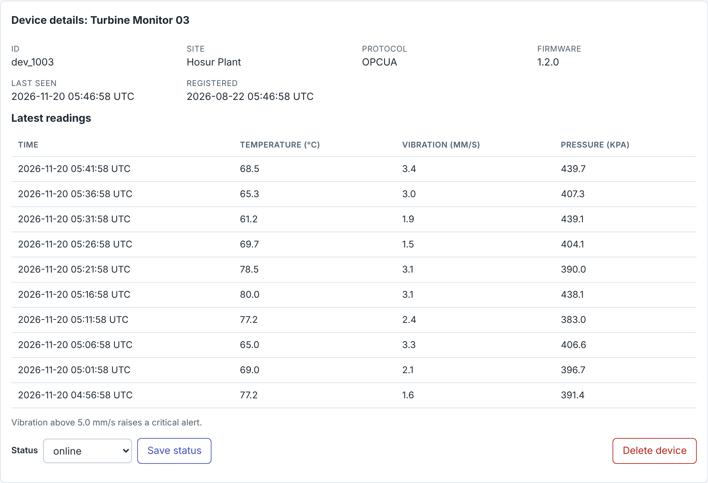
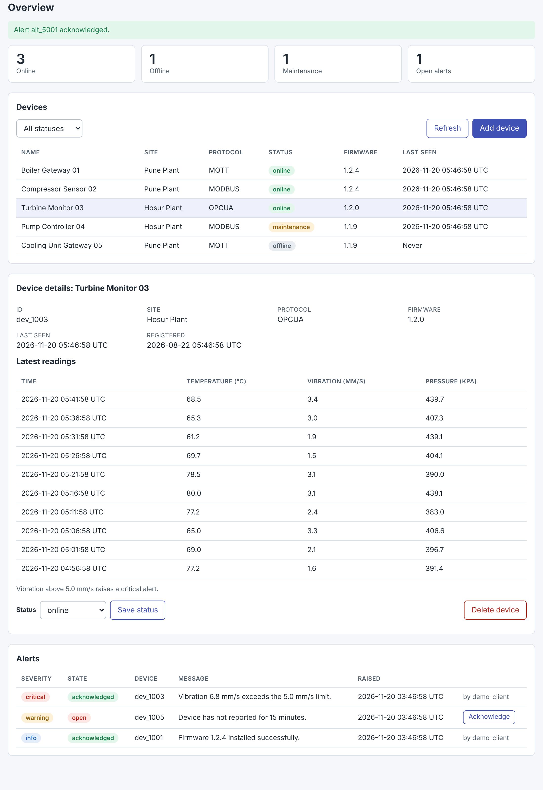

# Dashboard user guide

- **Audience:** Operators and field engineers who monitor devices in the EdgePulse dashboard.
- **Document type:** User guide
- **Applies to:** EdgePulse 1.2
- **Last updated:** 2026-11-20

## Overview

The EdgePulse dashboard shows the state of your devices and alerts on one page. You use it to see what needs attention, review recent readings, and acknowledge alerts.

## Purpose

After you read this guide, you can:

- Sign in and read the overview.
- Find a device and review its recent readings.
- Respond to an alert.

## Prerequisites

- The URL of your EdgePulse dashboard. For a local installation, it is <http://localhost:8000/dashboard>.
- A client ID and client secret from your administrator. The demo credentials are pre-filled in the sign-in form.

## Key concepts

| Term | Meaning |
|---|---|
| **Online** | The device has reported recently. |
| **Offline** | The device has not reported, or it is newly registered. |
| **Maintenance** | An administrator took the device out of normal monitoring. |
| **Last seen** | The time of the device's latest reading, in UTC. **Never** means the device has not reported. |
| **Open alert** | An alert that nobody has acknowledged. |
| **Acknowledged alert** | An alert that someone has reviewed. The dashboard shows who. |

### Alert severity

| Severity | What it means | What to do |
|---|---|---|
| **critical** | A reading is beyond a safety limit. Example: vibration above 5.0 mm/s. | Review the device immediately. |
| **warning** | A condition needs attention. Example: a device stopped reporting. | Check the device soon. |
| **info** | An event that needs no action. Example: a firmware update. | No action needed. |

### Alert life cycle

*Figure 1. The life cycle of an alert.*

## Procedures

### Sign in

1. Open the dashboard address in your browser.
2. Enter your **Client ID** and **Client secret**.
3. Select **Sign in**.

**Expected result:** The **Overview** page opens.

### Read the overview

The four counters at the top show how many devices are **Online**, **Offline** and in **Maintenance**, and how many alerts are open. The **Devices** table lists every device, and the **Alerts** table lists every alert, newest first.

The dashboard does not update by itself. Select **Refresh** to load the latest data.

*Figure 2. The dashboard overview.*

### Find a device

1. Open the status list above the **Devices** table.
2. Select a status: **online**, **offline** or **maintenance**.

**Expected result:** The table shows only devices with that status. Select **All statuses** to see every device again.

### Review a device and its readings

1. In the **Devices** table, select a device row.

**Expected result:** A **Device details** section opens below the table. It shows the device ID, site, protocol, firmware, last seen time and registration time. Below that, **Latest readings** lists the 10 newest readings with temperature, vibration and pressure.

A vibration value above 5.0 mm/s is shown in red.

*Figure 3. Device details and latest readings.*

### Respond to an alert

1. Select **Refresh** to load the latest alerts.
2. In the **Alerts** table, find the alert. Read its severity, device and message.
3. Select the device in the **Devices** table to review its readings.
4. Resolve the cause according to your site procedures.
5. In the **Alerts** table, select **Acknowledge** in the alert's row.

**Expected result:** A green message confirms the acknowledgement. The state changes to **acknowledged**, the row shows your client ID, and the **Open alerts** counter decreases by one.

*Figure 4. The dashboard after an alert is acknowledged.*

### Sign out

Select **Sign out** at the top right.

## Troubleshooting

| Message or problem | Cause | Solution |
|---|---|---|
| The client ID or client secret is incorrect. | A credential is mistyped. | Re-enter the credentials. If the error continues, ask your administrator. |
| Your session expired. Sign in again. | Your session lasts 60 minutes. | Sign in again. |
| This alert has already been acknowledged. | Someone else acknowledged the alert first. | Select **Refresh**. No further action is needed. |
| A device shows **Never** in **Last seen**. | The device has not sent a reading. | Ask your administrator to check the device connection. |
| The numbers look out of date. | The dashboard does not refresh automatically. | Select **Refresh**. |

## Best practices

- Select **Refresh** before you act on an alert.
- Review the device readings before you acknowledge a critical alert.
- Acknowledge an alert only after you have reviewed it. The acknowledgement records your client ID.

## Related information

- [Quick start](../quick-start/index.md)
- [Administrator guide](../admin-guide/index.md)
- [Product overview](../overview/index.md)
